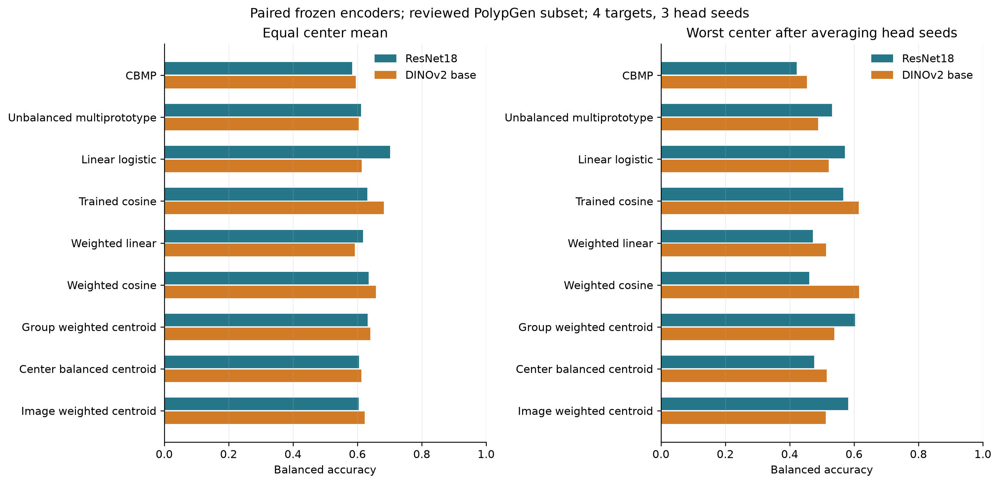
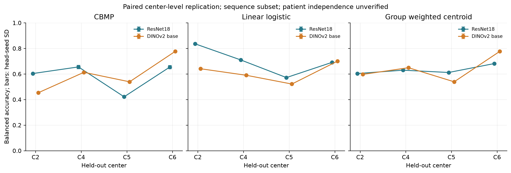
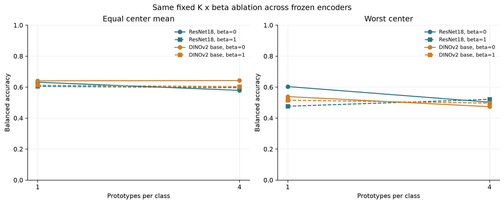

# Experiment 4: paired frozen DINOv2 replication

The DINOv2 base replication and fixed factorial ablation completed on exactly the original reviewed PolypGen subset: 5,444 frames, 37 sequences, held-out centers C2, C4, C5, C6, and fitting seeds 17, 29, 43. Source-only selection, candidate grids, calibration, and all frame/group/content partitions match the original ResNet18 experiment. Existing outputs remain unchanged.

## Main matched classifier comparison

| Classifier | ResNet18 mean BA | DINOv2 mean BA | ResNet18 worst BA | DINOv2 worst BA | Paired mean change (pp) |
|---|---:|---:|---:|---:|---:|
| CBMP | 58.3% | 59.5% | 42.1% | 45.3% | +1.19 |
| Unbalanced multiprototype | 61.1% | 60.4% | 53.1% | 48.9% | -0.68 |
| Linear logistic | 70.2% | 61.3% | 57.2% | 52.1% | -8.89 |
| Trained cosine | 63.1% | 68.2% | 56.7% | 61.4% | +5.04 |
| Weighted linear | 61.8% | 59.2% | 47.2% | 51.3% | -2.54 |
| Weighted cosine | 63.5% | 65.7% | 46.1% | 61.6% | +2.23 |
| Group weighted centroid | 63.2% | 64.0% | 60.3% | 53.9% | +0.88 |
| Center balanced centroid | 60.5% | 61.2% | 47.6% | 51.5% | +0.73 |
| Image weighted centroid | 60.4% | 62.3% | 58.2% | 51.2% | +1.91 |

## Fixed component ablation

| Encoder | K | beta | Mean BA | Worst BA | Mean AUROC |
|---|---:|---:|---:|---:|---:|
| ResNet18 | 1 | 0 | 63.2% | 60.3% | 79.0% |
| ResNet18 | 1 | 1 | 60.5% | 47.6% | 69.1% |
| ResNet18 | 4 | 0 | 57.9% | 50.3% | 68.8% |
| ResNet18 | 4 | 1 | 59.6% | 52.1% | 68.4% |
| DINOv2 base | 1 | 0 | 64.0% | 53.9% | 72.0% |
| DINOv2 base | 1 | 1 | 61.2% | 51.5% | 64.3% |
| DINOv2 base | 4 | 0 | 64.2% | 47.3% | 68.8% |
| DINOv2 base | 4 | 1 | 60.3% | 49.6% | 63.2% |

## Interpretation and limits

This comparison tests dependence on the pretrained representation. ResNet18 and DINOv2 differ in architecture, pretraining objective/data, and prescribed preprocessing; their difference does not isolate any one of these causes. No target results were used to change the predeclared DINOv2 checkpoint, preprocessing, classifier grids, or partitions.

This PolypGen subset was already inspected during prior experiments. This is an exploratory paired replication rather than a new untouched test cohort. Unresolved sequence mappings remain excluded. Center C5 positives and C2 negatives each come from one sequence; sequence grouping does not establish independent patients.

Paired conditional sequence bootstrap: 1026/2000 class-complete draws accepted. Every encoder, head, and fitting seed uses the same sampled whole sequences. Intervals condition on the observed centers and fixed fitted heads; they do not measure patient-level independence or hospital-population uncertainty. See paired_encoder_contrasts.csv and bootstrap_metadata.json.

108 DINOv2 final main fits and 48 fixed factorial final fits were evaluated. All 24 K=1 factorial prediction comparisons exactly matched the identical DINOv2 main centroid controls. Raw predictions, serialized heads, inner-source selection records, and exact feature/checkpoint hashes are saved beside this report.

## Frozen encoder provenance

Official Hugging Face checkpoint: `facebook/dinov2-base`, revision `f9e44c814b77203eaa57a6bdbbd535f21ede1415`; weight SHA-256 `d73036b56966966d07975d696bde331762f37297e2f095de8cea0040c3aa0841`. This checksum also matches the official Hugging Face pinned-revision LFS metadata; the public metadata and verification record are saved in ../checkpoint/. All model loads were offline and the architecture was required to resolve to Dinov2Model. Features are 768-dimensional final layer-normalized CLS vectors, L2 normalized. Evaluation mode, float32, no gradient updates. Processor configuration is pinned and hashed in ../experiment_config.json.

[Official model](https://huggingface.co/facebook/dinov2-base) · [DINOv2 authors' implementation](https://github.com/facebookresearch/dinov2)

Component effects for multiplicity, balancing and their interaction are in factorial_component_effects.csv, with paired conditional intervals for the equal-center mean and separate center-specific point effects. Positive or negative effects must be interpreted per encoder and center.

Overleaf artifacts: table_encoder_replication.tex and table_encoder_factorial.tex; scientific figures are available as PNG and vector PDF. Manuscript source files were not modified.
