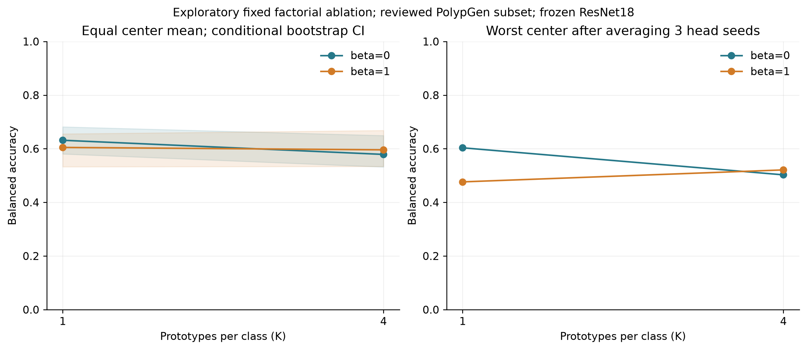

# Experiments 1–3: exploratory follow-up results

All three experiments completed on the same audited 5,444-frame/37-sequence subset, frozen ImageNet ResNet18 features, and four held-out centers C2,C4,C5,C6. The original test results had already been inspected when this follow-up protocol was designed, so independent confirmation remains necessary.

## Principal findings

1. Source-only threshold control changes CBMP mean balanced accuracy from 58.3% to 58.8%, with worst-center performance remaining 42.1%. It does not resolve the observed failure.
2. Within C5's mixed seq5, CBMP AUROC is 93.2%, while pooled C5 AUROC is 43.9%. Between-sequence score differences are an important descriptive lead. This does not establish a causal imaging artifact or patient-level effect.
3. Fixed multiplicity and center balancing do not consistently improve transfer. At K1, equal center weighting lowers the mean; K4 harms the mean relative to the unbalanced K1 control. Component interactions differ by center and must not be interpreted as universal invariance.
4. Source-composition stress gives no consistent CBMP advantage over matched total-group scarcity. Linear logistic retains the strongest mean performance in the evaluated stress conditions.

## Experiment 1: source-selected thresholds and failure analysis

Nine original classifiers x four targets x three fitting seeds = 108 threshold controls. The existing final heads are reused; their selected settings stay fixed. Each decision threshold uses only refitted inner source-fold margins. Score probabilities and AUROC do not change. All 140,967 original zero-threshold predictions were reproduced exactly.

| Classifier | Original mean BA (%) | Source-threshold mean BA (%) | Original worst BA (%) | Adjusted worst BA (%) |
|---|---:|---:|---:|---:|
| CBMP | 58.3 | 58.8 | 42.1 | 42.1 |
| Unbalanced multiple prototypes | 61.1 | 61.8 | 53.1 | 54.4 |
| Linear logistic | 70.2 | 69.4 | 57.2 | 57.9 |
| Trained cosine | 63.1 | 61.5 | 56.7 | 57.2 |
| Group/center weighted linear | 61.8 | 61.0 | 47.2 | 47.2 |
| Group/center weighted cosine | 63.5 | 58.4 | 46.1 | 45.0 |
| Group weighted centroid | 63.2 | 61.9 | 60.3 | 57.7 |
| Center balanced centroid | 60.5 | 57.4 | 47.6 | 50.9 |
| Image weighted centroid | 60.4 | 58.7 | 58.2 | 54.0 |

C2 has strong ranking but a poorly transferring operating point; its source-selected threshold reduces CBMP balanced accuracy from 60.3% to 57.7%. C5 has poor pooled ranking. Its single mixed sequence has high within-sequence ranking, while the three negative-only sequences have much lower specificity. Prototype contribution/effective-group tables, class-score summaries, and retrieval figures describe these associations without establishing clinical explanations.

[Experiment 1 report](exp1_failure/RESULTS.md) | [Threshold table](exp1_failure/table_threshold_control.tex) | [Sequence metrics](exp1_failure/sequence_metrics_seed_means.csv)

## Experiment 2: fixed K x beta factorial

Four fixed cells x four targets x three fitting seeds = 48 final evaluations. Group weighting is constant. Every realized class-prototype count matched its requested K. All 24 K=1 comparisons reproduced the corresponding original centroid predictions exactly. Temperatures use source-only validation NLL; no target score chooses a cell.

| K | beta | Mean BA (%) | Worst-center BA (%) | Mean AUROC (%) |
|---:|---:|---:|---:|---:|
| 1 | 0 | 63.2 | 60.3 | 79.0 |
| 1 | 1 | 60.5 | 47.6 | 69.1 |
| 4 | 0 | 57.9 | 50.3 | 68.8 |
| 4 | 1 | 59.6 | 52.1 | 68.4 |

| Paired contrast | Mean BA change (pp) | Conditional 95% interval (pp) |
|---|---:|---:|
| multiplicity_at_beta0 | -5.28 | [-10.75, +2.35] |
| multiplicity_at_beta1 | -0.90 | [-6.28, +7.54] |
| balancing_at_K1 | -2.67 | [-7.72, -1.09] |
| balancing_at_K4 | +1.71 | [-1.52, +4.79] |
| interaction_difference_in_differences | +4.38 | [+1.84, +9.11] |

The 2,000 whole-sequence bootstrap attempts accepted 1,026 class-complete draws. Intervals pair identical resamples across cells and fitting seeds, are conditional on fixed trained heads and four observed centers, and do not establish independent patients or population-level hospital uncertainty. These exploratory component intervals are descriptive.

[Experiment 2 report](exp2_factorial/RESULTS.md) | [Factorial table](exp2_factorial/table_factorial.tex) | [Per-center effects](exp2_factorial/paired_effects.csv)

## Experiment 3: source composition versus matched group scarcity

48 unique retained-source conditions x six classifier variants = 288 new target evaluations. Fitting seed 17 stays fixed; source-subset seeds 101, 211, and 307 vary whole retained sequences. Each source center keeps its original observed class vocabulary, and every original class-complete source-validation center remains available. All 288 selected configurations and metrics were reconstructed from saved searches and 375,912 per-frame predictions.

The composition arm reduces the source center with the largest number of groups: C6 for targets C2,C4,C5, and C4 for target C6. The paired scarcity control retains the same total number of groups with proportional class-covering source quotas. Frame counts and label prevalence are not matched and are disclosed. Reducing a dominant center may reduce source imbalance; retention is not a monotonic increasing-domain-shift scale.

| Classifier | Dominant-center retention | Composition mean / worst BA (%) | Matched mean / worst BA (%) | Composition minus matched (pp) |
|---|---:|---:|---:|---:|
| CBMP | 50% | 59.7 / 40.3 | 58.6 / 42.9 | +1.0 |
| CBMP | 25% | 58.7 / 43.6 | 59.3 / 46.2 | -0.7 |
| Unbalanced multiple prototypes | 50% | 61.9 / 50.1 | 62.2 / 53.2 | -0.4 |
| Unbalanced multiple prototypes | 25% | 61.6 / 50.1 | 62.2 / 54.4 | -0.6 |
| Linear logistic | 50% | 69.2 / 57.7 | 67.0 / 58.9 | +2.1 |
| Linear logistic | 25% | 68.4 / 53.8 | 65.7 / 58.8 | +2.7 |
| Trained cosine | 50% | 63.0 / 55.2 | 63.1 / 58.5 | -0.1 |
| Trained cosine | 25% | 62.6 / 53.2 | 63.4 / 59.5 | -0.7 |
| Group/center weighted linear | 50% | 65.2 / 45.0 | 63.9 / 44.7 | +1.4 |
| Group/center weighted linear | 25% | 64.6 / 46.7 | 62.4 / 53.8 | +2.1 |
| Group weighted centroid | 50% | 62.7 / 56.2 | 62.5 / 59.0 | +0.2 |
| Group weighted centroid | 25% | 61.7 / 49.3 | 62.9 / 59.1 | -1.2 |

CBMP's composition-minus-control effect changes sign between retention levels. The three subset-seed effects vary substantially; no naive pooled p-value or confidence interval over hospitals is claimed. Each center is weighted equally after averaging its subset metrics. The full-source anchors use original seed 17 only, separately from the three-fitting-seed averages used in experiments 1–2.

[Experiment 3 report](exp3_stress/RESULTS.md) | [Sampling audit](exp3_stress/SAMPLING.md) | [Stress table](exp3_stress/table_stress.tex)

## Relation to the manuscript

The current results support a conditional, diagnostic account of prototype transfer. They do not support an empirical advantage for the current CBMP mechanism. The most informative observation is the mismatch between within-sequence and pooled-center ranking, alongside component sensitivity and sparse source support. Any new mechanism suggested by these findings needs a separately frozen independent evaluation.

The manuscript still needs reconciliation with actual execution before experiments are inserted: this study uses frozen ResNet18 and a partial reviewed sequence subset; temperature selection is the implementation's bounded continuous source-NLL optimization, whereas the draft lists a discrete grid. Existing manuscript files were not edited.

## Verification and preservation

Experiment 1: 25 focused checks and 108 cached source-threshold endpoint checks. Experiment 2: 24 exact baseline-centroid prediction comparisons and all 48 realized-capacity checks. Experiment 3: 10 focused sampling/partition checks, then reconstruction of 288 target records and their source-selected settings. Preservation check: 50,169 protected files unchanged by size/mtime; 217 baseline artifacts unchanged by SHA-256.

All results remain conditional on the reviewed subset. C2 negatives and C5 positives each occur in one sequence. Sequence IDs do not establish patient independence. Unresolved release center mappings remain excluded. No new dataset or encoder was introduced.

The exact frozen design is in [PROTOCOL.md](PROTOCOL.md). Raw evidence, code, logs, models, CSVs, figures, and TeX fragments are local to this folder. The previous data, runs, outputs, and open manuscript remain unchanged.
