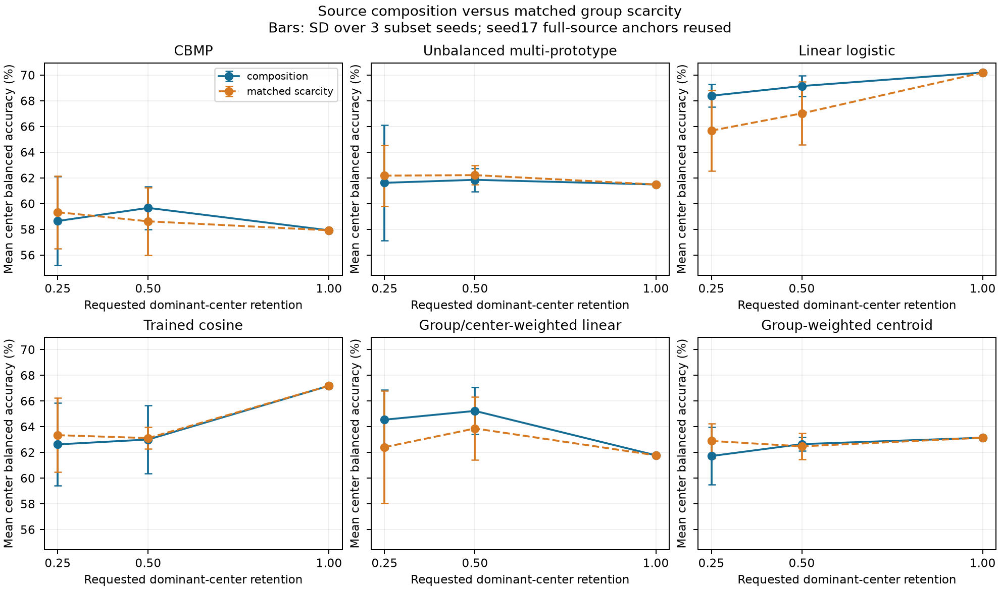
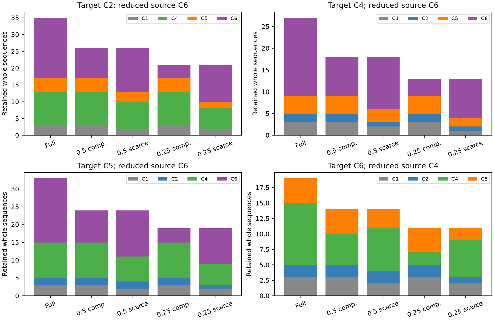

# Experiment 3: source composition and matched group scarcity

Exploratory analysis of the already reviewed PolypGen subset: frozen ImageNet ResNet18, 5,444 frames, 37 sequences, four fixed target centers. Sequence IDs do not establish independent patients. C2 negatives and C5 positives each occupy one sequence.

Completed 48 source conditions and 288 target evaluations. Every condition retains whole sequences and each source center's original class vocabulary. Source-only nested selection uses the unchanged baseline grids and calibration. Optimization seed17 is fixed; sampling seeds101/211/307 vary retained source groups. Repeated subsets are recorded explicitly and are not independent repetitions.

The composition arm reduces only the source center with most groups. The scarcity control uses exactly the same total group budget with proportional, class-covering quotas. These controls are not matched for frame count or class prevalence; those counts are saved. Less dominant-center retention need not mean greater source imbalance. Source subsets and all fold indices were written before classifier fitting.

| Method | Dominant retention | Composition mean / worst (%) | Matched scarcity mean / worst (%) | Composition minus matched (pp) |
|---|---:|---:|---:|---:|
| CBMP | 0.5 | 59.7 / 40.3 | 58.6 / 42.9 | +1.0 |
| CBMP | 0.25 | 58.7 / 43.6 | 59.3 / 46.2 | -0.7 |
| Unbalanced multi-prototype | 0.5 | 61.9 / 50.1 | 62.2 / 53.2 | -0.4 |
| Unbalanced multi-prototype | 0.25 | 61.6 / 50.1 | 62.2 / 54.4 | -0.6 |
| Linear logistic | 0.5 | 69.2 / 57.7 | 67.0 / 58.9 | +2.1 |
| Linear logistic | 0.25 | 68.4 / 53.8 | 65.7 / 58.8 | +2.7 |
| Trained cosine | 0.5 | 63.0 / 55.2 | 63.1 / 58.5 | -0.1 |
| Trained cosine | 0.25 | 62.6 / 53.2 | 63.4 / 59.5 | -0.7 |
| Group/center-weighted linear | 0.5 | 65.2 / 45.0 | 63.9 / 44.7 | +1.4 |
| Group/center-weighted linear | 0.25 | 64.6 / 46.7 | 62.4 / 53.8 | +2.1 |
| Group-weighted centroid | 0.5 | 62.7 / 56.2 | 62.5 / 59.0 | +0.2 |
| Group-weighted centroid | 0.25 | 61.7 / 49.3 | 62.9 / 59.1 | -1.2 |

Mean gives every target center equal weight after averaging its three subset-seed scores. Worst center is computed after that within-center averaging. Error bars show sampling-seed SD of the four-center mean; they are not confidence intervals over hospitals. All source-seed and per-center values, paired deltas, class counts, exact selected groups, selected configurations, predictions and models are available alongside this report. No naive pooled significance tests are used.

Full-source anchors come from the unchanged baseline seed17 metrics, rather than refitting. Changes relative to those anchors are in metrics_per_condition.csv. Source center C1 remains negative-only and is excluded as an inner validation target under exactly the original rule; all original class-complete validation centers remain represented.

Interpret these measurements as conditional on the reviewed subset and its sparse class-bearing sequences. They cannot establish a general causal relationship between source-center imbalance and transfer, or independent confirmation after earlier target inspection.

